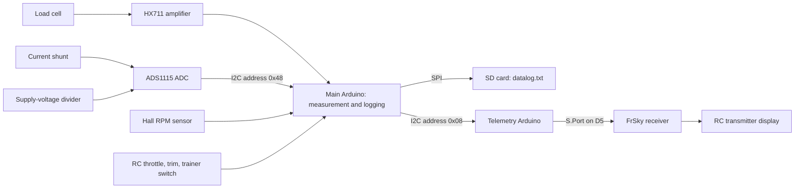

# Thrust Tester Rig

A large thrust test stand built by Hacksmith for testing and logging the performance of large propellers, electric ducted fans, and jet engines.

This repository preserves the original Arduino sketches, sensor test programs, SolidWorks files, and bundled libraries so the rig can be understood, restored, and developed further. The firmware measures thrust, receiver throttle, supply voltage, current, and RPM; later versions write measurements to an SD card and relay selected values to a FrSky radio through a second Arduino.

**Project status:** legacy project being brought back into service. The original sketches and mechanical files are preserved. The ESP32-S3 Zero gateway and replacement measurement Nano firmware now build, have passed bench checks, and exchange live data through USB at 115200 baud. Reference calibration, SD backup and completed recording/download tests remain to be verified. The legacy documentation below is based on source review; it does not establish physical operating limits.

**Current restoration path:** [`ESP32_USB_Gateway/`](ESP32_USB_Gateway/) adds the ESP32-S3 Zero USB host, Wi-Fi phone dashboard, live plots, calibration controls and local recordings/downloads. [`Nano_USB_Controller/`](Nano_USB_Controller/) replaces the firmware on the **measurement Nano only**, retaining its soldered sensors and optional SD backup. Leave the separate FrSky telemetry Nano unchanged. Both use **115200 baud**; change the gateway's original 9600 setting after the Nano update.

Join **ThrustTester** (initial password **ThrustRig-2026**) and open **http://192.168.4.1**. The Zero requires a regulated 5V feed for USB-host operation; follow the [power and hookup guide](ESP32_USB_Gateway/README.md#hardware-and-usb-power). The phone starts/stops runs on ESP32 flash and downloads CSV/metadata. The Nano independently records `RIGnnnnn.CSV` on its existing SD module when available. No SD file synchronization is implemented.

Build/upload instructions and measured results: [gateway guide](ESP32_USB_Gateway/README.md), [gateway tests](ESP32_USB_Gateway/HARDWARE_TEST.md), [Nano guide](Nano_USB_Controller/README.md), [Nano tests](Nano_USB_Controller/HARDWARE_TEST.md), and [wire protocol](ESP32_USB_Gateway/PROTOCOL.md). The following sections document the historical rig and sketches; the linked restoration guides describe their replacement behavior.

## Contents

- [What the rig does](#what-the-rig-does)
- [System overview](#system-overview)
- [Repository layout](#repository-layout)
- [Hardware and wiring](#hardware-and-wiring)
- [Software and dependencies](#software-and-dependencies)
- [Getting started](#getting-started)
- [Measurements and calibration](#measurements-and-calibration)
- [SD card logging](#sd-card-logging)
- [FrSky telemetry](#frsky-telemetry)
- [Known issues and restoration work](#known-issues-and-restoration-work)
- [Mechanical design](#mechanical-design)
- [Development priorities](#development-priorities)
- [Credits and licensing](#credits-and-licensing)

## What the rig does

The stand provides a common platform for comparing propulsion systems under static test conditions. The preserved software supports:

- **Thrust measurement:** a load cell read through an HX711 amplifier.
- **Electrical measurements:** an ADS1115 ADC measuring a current shunt and a supply-voltage divider.
- **RPM measurement:** Hall sensor transitions counted against a configurable number of magnetic poles.
- **Throttle monitoring:** pulse-width measurement of an RC receiver channel.
- **Local recording:** comma-separated measurements appended to `datalog.txt` on an SD card.
- **Radio telemetry:** voltage, current, RPM, and thrust relayed through a separate Arduino to a FrSky S.Port receiver.
- **Field calibration in version 4:** receiver trim and trainer-switch channels adjust the load-cell calibration and magnetic pole count, with settings saved to EEPROM.

The rig was used with propellers, ducted fans, and jet engines. Which channels are useful depends on the test article and installed sensors. The archived firmware does not contain jet-specific fuel-flow, exhaust-temperature, or engine-controller integration.

Throttle is an **observed receiver input**. These sketches do not generate an ESC throttle command or implement an engine shutdown system.

## System overview

Version 4 is the most developed measurement-and-telemetry sketch in the archive and the starting point for the description below. Its filename does not establish that it was the last firmware loaded on the rig.



The main loop targets **10 measurement cycles per second**. Each cycle reads the ADC and load cell, calculates RPM and throttle, processes calibration inputs, sends telemetry, and writes a log row when the activity condition is met. Sensor reads and SD writes can extend the cycle, so 10 Hz is a nominal rate.

## Repository layout

Original names and nested folders are retained, including the unusual `.ino.ino` filenames.

| Path | Purpose |
| --- | --- |
| [`ESP32_USB_Gateway/`](ESP32_USB_Gateway/) | Active ESP32-S3 Zero USB host, offline phone dashboard and flash recording. |
| [`Nano_USB_Controller/`](Nano_USB_Controller/) | Active ATmega328P measurement firmware: USB calibration/configuration, sensor acquisition and continuous SD backup. |
| [`Thrust_Tester_Software/`](Thrust_Tester_Software/) | Original serial-output sketch. Polls the Hall sensor on D5; throttle calculation is disabled and reported as zero. |
| [`Thrust_Tester_Software_2.0/`](Thrust_Tester_Software_2.0/) | Adds pin-change interrupt handling for RPM and receiver PWM; retains the earlier Hall polling code. |
| [`aaThrust_Tester_Software_3/`](aaThrust_Tester_Software_3/) | Adds SD logging and contains telemetry experiments, a separate bridge sketch, and an `Unused Libraries` snapshot. Its RPM/PWM interrupt vector needs correction. |
| [`Thrust_Tester_Software_SchublerCalib/`](Thrust_Tester_Software_SchublerCalib/) | Logging variant with a fixed load-cell factor of `30312`, 20 magnetic poles, and serial output at 115200 baud. Telemetry transmission is commented out. |
| [`Thrust_Tester_Software_4.0_Telemetry/`](Thrust_Tester_Software_4.0_Telemetry/) | Main logger with EEPROM settings, receiver-assisted calibration, and I2C telemetry output. |
| [`Thrust_Tester_Software_4.0_Telemetry/Telemetry_Write/`](Thrust_Tester_Software_4.0_Telemetry/Telemetry_Write/) | Separate firmware for the FrSky telemetry Arduino, plus an extracted FrSky library and its ZIP archive. |
| [`Load_Cell_Test/`](Load_Cell_Test/) | HX711 calibration sketch; serial `+` / `a` and `-` / `z` adjust the factor in steps of 10. |
| [`ADC_Shunt_Test/`](ADC_Shunt_Test/) | Prints ADS1115 readings, shunt voltage, calculated current, and supply voltage. |
| [`Hall_Effect_Test/`](Hall_Effect_Test/) | Polling-based Hall sensor test on D5, configured for 14 poles and a one-second RPM window. |
| [`PWM_Interrupt_Test/`](PWM_Interrupt_Test/) | Measures PWM on A0 and sends a mapped two-byte value over I2C to address 8. This is a standalone experiment, not the version 4 telemetry packet. |
| [`Datalogger_Test/`](Datalogger_Test/) | Arduino SD example adapted to append analog readings from A0–A2. |
| [`libraries/`](libraries/) | Historical bundle of 19 Arduino libraries, most unrelated to the rig's active sketches. Preserved for reference. |
| Root `*.SLDASM` / `*.SLDPRT` files | SolidWorks stand assembly and component models. |

Each `.ino` entry is an independent sketch unless it belongs to that sketch's own source folder. The main logger and `Telemetry_Write` are uploaded to **different boards**.

## Hardware and wiring

### Controller assumptions

The main firmware directly uses AVR registers and interrupt vectors such as `PINB`, `PIND`, `PCICR`, and `PCINT0_vect`. The following pin map is inferred from **ATmega328P Uno/Nano-style mapping**. Confirm the actual board before using it; this is not a portable pin map for a Mega, ESP32, or other controller.

The bundled FrSky implementation also contains an ATmega328P-specific path. Its support for some Teensy boards does not make the main logger compatible with those boards.

### Main logger: version 4

| Connection | Pin / address | Source behavior |
| --- | --- | --- |
| HX711 data (`DOUT`) | D3 | Load-cell input. |
| HX711 clock (`CLK`) | D2 | Load-cell clock. |
| SD card chip select | D4 | `chipSelect = 4`. |
| SD card MOSI | D11 | Hardware SPI on the assumed ATmega328P board. |
| SD card MISO | D12 | Hardware SPI. |
| SD card SCK | D13 | Hardware SPI. |
| Calibration trim input | D5 | Receiver PWM captured through `PCINT2_vect`. |
| Trainer-switch input | D6 | Receiver PWM selecting calibration mode. |
| Hall RPM input | **D8** | ISR reads `PINB` bit 0 and counts both rising and falling transitions. |
| Receiver throttle input | D9 | ISR reads `PINB` bit 1 and measures pulse width. |
| I2C SDA / SCL | A4 / A5 | Shared bus to the ADS1115 and telemetry Arduino on the assumed board. |
| ADS1115 | `0x48` | Single-ended channel 0: shunt; channel 1: voltage divider. |
| Telemetry Arduino | `0x08` | Main logger sends the measurement packet to this I2C address. |

**The Hall pin differs between sketches.** The standalone Hall test uses D5. Version 4 uses D5 for trim and reads RPM on D8. Some earlier sketches still declare `HallPin = 5` while their interrupt code reads D8. Follow the code for the selected sketch and verify the harness.

### Telemetry Arduino

| Connection | Pin / address |
| --- | --- |
| I2C SDA / SCL | A4 / A5 on an ATmega328P Uno/Nano-style board |
| I2C slave address | `0x08` |
| FrSky S.Port signal | D5, selected by `SOFT_SERIAL_PIN_5` |
| Ground reference | Shared with the logger and connected telemetry hardware |

The repository does not include a complete electrical schematic, connector pinout, or verified bill of materials. Check board supply voltages, ADC input limits, shunt placement, divider values, SD-module logic levels, I2C pull-ups, and the S.Port interface against the installed components. The software constants do not establish electrical or mechanical operating limits.

## Software and dependencies

There is no pinned build environment or automated build configuration in the archive. The sketches use historical Arduino library interfaces.

| Dependency | Used for | Archive status |
| --- | --- | --- |
| Arduino AVR core: `Wire`, `SPI`, `EEPROM` | I2C, SPI, persistent settings | Expected from the board package; the core and compiler are not bundled. |
| `SD` | SD card logging | Bundled in `libraries/SD`; its metadata reports version `1.1.1`. |
| HX711 library | Load-cell amplifier | **Missing.** Sketches expect `HX711 scale(DOUT, CLK)` and methods such as `tare()` and `set_scale()`. The calibration sketch credits bogde's HX711 library. |
| Adafruit ADS1x15 library | ADS1115 ADC | **Missing.** Sketches include `Adafruit_ADS1015.h` and construct `Adafruit_ADS1115 ads(0x48)`. |
| FrSky S.Port library | Telemetry bridge | Bundled under `Thrust_Tester_Software_4.0_Telemetry/Telemetry_Write/FrSky_SPORT_Arduino-master/`; changelog includes version `20150921`. |
| `SoftwareSerial` | ATmega328P S.Port transport | Normally supplied by the AVR board package; another historical copy exists in `aaThrust_Tester_Software_3/Unused Libraries/`. |

Recover compatible HX711 and ADS1x15 versions, or deliberately update the sketches to the interfaces of chosen replacements. Do not assume a library with the same name will compile against these old constructor and header conventions. Record exact board-package and library versions once a build succeeds.

The root `libraries/` folder is an archive, not a complete dependency installation. Installing every archived library is unnecessary. The nested FrSky source must be installed as a discoverable Arduino library or included through a deliberate build configuration; its presence beside `Telemetry_Write.ino` is not a complete library setup.

## Getting started

### 1. Obtain the project

```sh
git clone https://github.com/HacksmithBogdan/Thrust-Tester-Rig.git
cd Thrust-Tester-Rig
```

Keep the historical sketches intact while establishing a working baseline. Record which board and firmware are currently fitted before replacing anything, and preserve the current EEPROM calibration values if they are recoverable.

### 2. Establish the build environment

1. Identify both controller boards and their bootloader/processor settings.
2. Set up an Arduino development environment with the matching board package.
3. Recover the missing HX711 and ADS1x15 libraries with the required interfaces, and install the FrSky library for the telemetry board.
4. Open and compile the selected sketch before uploading it. Use version 4 as the source-review starting point, with the issues below accounted for.

Main logger:

```text
Thrust_Tester_Software_4.0_Telemetry/Thrust_Tester_Software_4.0_Telemetry.ino
```

Separate telemetry bridge:

```text
Thrust_Tester_Software_4.0_Telemetry/Telemetry_Write/Telemetry_Write.ino
```

Some earlier sketches are stored as `Name.ino/Name.ino.ino`. If the Arduino environment rejects that naming, make a working copy with a conventional matching sketch-folder and `.ino` name. Keep the archived original for comparison.

### 3. Check each measurement independently

Perform electronics and calibration checks with propulsion power disconnected. Inspect the stand, restraints, wiring, high-current connections, and an independent means of shutting down the test article before powered testing.

| Check | Sketch / procedure | Detail to confirm |
| --- | --- | --- |
| SD card | `Datalogger_Test` | Card initialization, writing, and recovery of `datalog.txt`. Its A0–A2 values are example analog readings. |
| Load cell | `Load_Cell_Test` | Zero, direction, repeatability, and known-load calibration; serial at 9600 baud. |
| Voltage and current | `ADC_Shunt_Test` | Compare with reference instruments; serial at 9600 baud. Its shunt constant differs from version 4. |
| RPM | `Hall_Effect_Test` | D5 input, both-edge counting, and the correct transitions per revolution. Its 14-pole setting is a test default. |
| Receiver PWM | `PWM_Interrupt_Test` | A0 capture and I2C output. Serial output is commented out; adapt instrumentation deliberately if needed. |

### 4. Validate the integrated logger

Before using version 4, establish valid EEPROM settings and resolve or account for its startup and measurement issues. It tares the load cell during startup, so remove external thrust/calibration force while establishing zero.

Version 4 opens serial at **9600 baud**, but `DEBUG` is commented out, so its diagnostic messages are disabled. The Schubler calibration variant prints at **115200 baud**. Use the setting of the sketch actually uploaded.

Confirm the log file, channel units, no-load readings, PWM endpoints, RPM scale, and telemetry values against known inputs. Archive each completed run with the test-article details and calibration record. Proceed to controlled propulsion tests only after these checks and a physical assessment of the rig's condition and limits.

## Measurements and calibration

### Conversion constants in version 4

| Setting | Value in source | Interpretation |
| --- | --- | --- |
| `RefreshRate` | `10` | Target cycles per second; also used in the RPM calculation. |
| `ShuntResistance` | `0.000192` ohm | Effective shunt resistance used to calculate amperes. |
| `VoltageDividerRatio` | `34.13` | Multiplier from ADC channel 1 voltage to supply voltage. |
| ADC conversion | `0.1875` mV/count | Conversion assumed by the code; verify that ADC gain and wiring match it. |
| `calibration_factor` | `30312` initially | Immediately overwritten from EEPROM in version 4. |
| `MagnetPoles` | `20` initially | Immediately overwritten from EEPROM in version 4. |

The calculations are:

```text
shunt_voltage_V = adc0 * 0.1875 / 1000
divider_voltage_V = adc1 * 0.1875 / 1000
current_A = shunt_voltage_V / ShuntResistance
supply_voltage_V = divider_voltage_V * VoltageDividerRatio
rpm = transitions_in_window / MagnetPoles * 60 * RefreshRate
throttle_percent = map(pulse_width_us, 1000, 2000, 0, 1000) / 10
```

RPM counts both Hall signal edges. `MagnetPoles` must match the **counted transitions per mechanical revolution** for the actual sensor arrangement. Confirm it against an independent RPM reference. The current calculation uses the configured rate rather than the actual elapsed window, which can introduce error when a loop runs late.

The load-cell test labels readings `kg`. With calibration against a known mass under gravity, the thrust reading can be interpreted as kilogram-force equivalent (**kgf**). The main log header does not specify a thrust unit; establish and record the actual calibration convention before comparing results. If calibrated in kgf, conversion to newtons is `N = kgf * 9.80665`.

Historical comments mention factors such as `39000`, `38000`, `27463.6`, and `30312` for different setups. These are references, not transferable calibrations. Version 4's receiver adjustment path only accepts positive factors between 2000 and 140000; reverse load-cell polarity or negative-force operation needs separate review.

### Version 4 receiver-assisted adjustment

The trim pulse is mapped from 1000–2000 microseconds to approximately -500…+500 in `TrimIN`. At the nominal loop rate, a held trim repeatedly applies adjustments.

| Trainer-switch pulse | Action |
| --- | --- |
| Greater than 500 and less than 1200 microseconds | Subtract `TrimIN` from the load-cell factor, subject to the factor bounds. |
| Greater than 1800 microseconds | Add `int(TrimIN / 100)` to the pole count, subject to the code's bounds. |
| Greater than 1200 and less than 1800 microseconds | Save queued changes to EEPROM. |

The thresholds are strict comparisons; exact boundary values do not enter those branches. The transmitter channel assignment and switch direction must be verified on the actual radio.

### EEPROM layout

| Address | Stored value |
| --- | --- |
| `0` | Low byte of the integer load-cell factor divided by 10. |
| `1` | High byte of the same value. |
| `2` | Magnetic pole / transition count. |

Version 4 reconstructs the first two bytes and multiplies by 10, so stored calibration has ten-unit resolution. No validity marker, version, checksum, or startup range validation is implemented. Blank or stale EEPROM overrides the constants in the source, and a zero pole count makes the RPM calculation invalid. Validate or initialize these settings before relying on the measurements.

## SD card logging

The logging sketches append to **`datalog.txt`** in the SD card root. Version 4 writes this header at every startup:

```csv
Time, Thrust, Throttle, Vbat, Current, RPM
```

| Column | Meaning |
| --- | --- |
| `Time` | Seconds since controller startup, derived from `millis()`. |
| `Thrust` | Calibrated load-cell value; establish the unit as described above. |
| `Throttle` | Receiver pulse mapped to percent; the code does not clamp the result. |
| `Vbat` | Supply voltage in volts. |
| `Current` | Current in amperes using the configured shunt resistance. |
| `RPM` | Calculated mechanical revolutions per minute. |

A row is written when **any** of these conditions is true:

```text
throttle >= 1.0 OR thrust >= 0.5 OR rpm >= 1
```

Measurements continue when this condition is false, but no data row is written. The thrust threshold uses the configured load-cell unit and is a positive threshold, so negative thrust alone does not trigger recording.

The file is opened, appended to, and closed for each recorded row. It can be imported as comma-separated text into a spreadsheet or analysis tool. Reboots append another header and restart the timestamp at zero; there is no real-time clock, unique run filename, test identifier, or calibration metadata in the file. Split runs and remove repeated headers as needed during analysis. Preserve the original log before processing it.

No historical test logs or analysis application were present in the imported folder.

## FrSky telemetry

The main Arduino sends an I2C packet to address `8` once per measurement cycle. Multi-byte fields are sent low byte first. On the assumed AVR target, the four measurement fields are held in signed 16-bit `int` values.

| Byte offsets | Field | Encoding in the main logger |
| --- | --- | --- |
| `0–1` | Thrust | `int(Thrust * 100)` |
| `2–3` | Supply voltage | `int(Vbat * 100)` |
| `4–5` | Current | `int(Current * 10)` |
| `6–7` | RPM | `int(rpm / 2)` |
| `8` | Pole count | One byte |

The version 4 bridge decodes **only the first eight bytes** and ignores the pole-count byte. The older bridge under `aaThrust_Tester_Software_3/Telemetry Write/Telemetry_Write/` reads all nine and exposes pole count in a temperature field. These two bridge sketches must not be assumed equivalent.

The bridge presents:

- Voltage and current through a FrSky FCS sensor instance.
- RPM through a FrSky RPM sensor instance. The bundled library multiplies the supplied RPM by two, explaining the main logger's `rpm / 2` encoding. Check transmitter-side RPM configuration against a reference.
- Thrust through the **voltage field of a second FCS instance**, using sensor ID `ID15`. Configure the transmitter's label and interpretation to match the calibrated thrust unit.

The bridge does not validate `howMany`, detect stale measurements, or take an atomic snapshot of the values changed by its I2C receive callback. Field range, signed values, and loss-of-communication behavior need review before depending on the radio display.

## Known issues and restoration work

These findings come from inspecting the preserved source. They are not fixes already applied to the firmware.

| Area | Finding and consequence |
| --- | --- |
| Reproducible build | HX711 and ADS1x15 libraries are absent; original board-package, compiler, and library versions are unknown. A clean build has not been established. |
| EEPROM startup | Version 4 unconditionally replaces its defaults with unchecked EEPROM bytes. Calibration and RPM scale may be invalid after a board change or erased EEPROM. |
| SD startup failure | A failed `SD.begin()` returns from `setup()` before ADC/load-cell initialization completes, but Arduino still calls `loop()`. With version 4 diagnostics disabled, the failure is also silent. |
| Interrupt-shared state | Main-loop and ISR values such as pulse widths and the RPM counter are not declared `volatile` or read/reset atomically. The telemetry bridge similarly shares multi-byte values with its receive callback. |
| RPM timing | RPM assumes an exact `1 / RefreshRate` measurement window. Sensor and SD latency can change that window. |
| Receiver signal validity | Missing or stale PWM is not detected, and throttle is not clamped. Calibration input validity is incomplete, including the high trainer-switch branch. |
| Telemetry protocol | The main logger sends nine bytes; the version 4 bridge consumes eight. Packet size, signed decoding, ranges, and stale-data behavior are not validated. |
| Historical interrupt mapping | Version 3 enables the port-B interrupt group but defines `PCINT1_vect` for its handler. Some older declarations and comments also disagree with the pins used by the ISR. |
| Voltage/current calibration | Hard-coded shunt, divider, and ADC scale assumptions must be checked against the installed hardware and reference instruments. |
| Run records | All runs append to one file with repeated headers and resetting timestamps. No board, calibration, or test-article metadata is captured. |
| Long-running reliability | Repeated dynamic `String` construction, blocking sensor reads, per-row SD access, and signed millisecond timekeeping need assessment on the actual controller. |

## Mechanical design

The root contains these native SolidWorks files:

| File | Role indicated by filename |
| --- | --- |
| [`Stand.SLDASM`](Stand.SLDASM) | Stand assembly. |
| [`Thrust Stand.SLDPRT`](Thrust%20Stand.SLDPRT) | Stand component. |
| [`Load Cell Mount.SLDPRT`](Load%20Cell%20Mount.SLDPRT) | Load-cell mounting component. |
| [`Shaft.SLDPRT`](Shaft.SLDPRT) | Shaft component. |
| [`Bearing.SLDPRT`](Bearing.SLDPRT) | Bearing component. |
| [`Pillow Bearing.SLDPRT`](Pillow%20Bearing.SLDPRT) | Pillow-bearing component. |

Open the assembly with the part files available together. Assembly references, geometry, materials, fabrication details, and completeness have not been verified in CAD. The archive contains no neutral STEP exports, fabrication drawings, complete BOM, or documented load ratings. Confirm the physical stand against the models before treating them as an as-built record.

## Development priorities

1. **Recover a working baseline:** identify the installed boards and wiring, preserve existing calibration, recover compatible dependencies, and record a successful build for both controllers.
2. **Make startup and configuration reliable:** validate EEPROM, establish explicit defaults and units, report sensor/SD errors, and prevent measurement code from running with incomplete initialization.
3. **Verify measurements:** calibrate the load cell, shunt, divider, and RPM scale; use elapsed time for RPM; handle ISR data consistently and detect lost receiver signals.
4. **Align telemetry:** define one packet format with fixed-width types, matching sender/receiver lengths, clear scaling, range checks, and stale-data handling.
5. **Improve test records:** create distinct run files, store calibration and test metadata, and make the sampling behavior explicit.
6. **Complete the hardware record:** add an electrical schematic, connector map, component list, CAD exports, photographs, and confirmed operating limits.

Future changes should identify the sketch and hardware configuration they target and include the measurements or checks used to validate the result. Keep historical variants available while establishing a maintained firmware version.

## Credits and licensing

- Original rig and project: **Hacksmith**.
- The load-cell calibration sketch credits **Nathan Seidle / SparkFun** and references **bogde's HX711 library**.
- The SD datalogger example credits **Tom Igoe / Arduino**.
- The bundled FrSky S.Port implementation credits **Pawelsky**; its README identifies it as a mirror of the encoder shared on RC Groups.
- Other bundled Arduino libraries retain their own authorship and license notices.

No project-wide license was included with the original folder, and this import does not assign one. Third-party notices remain in their source files. In particular, the bundled FrSky source headers state **"Not for commercial use"**; do not assume the entire archive has a single permissive license.
